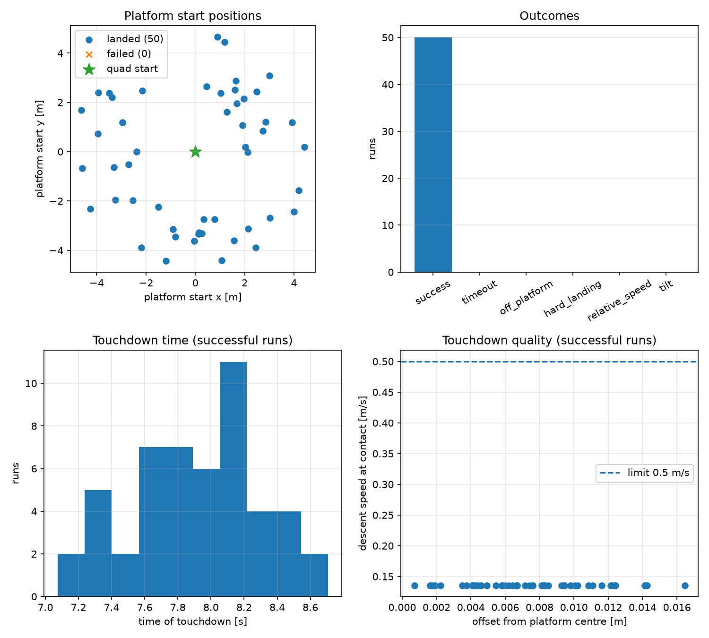
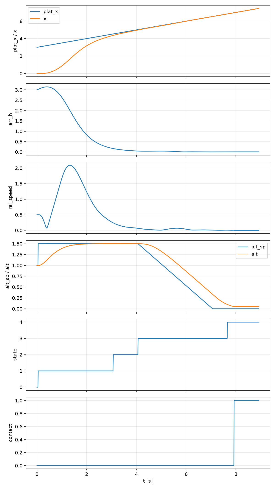
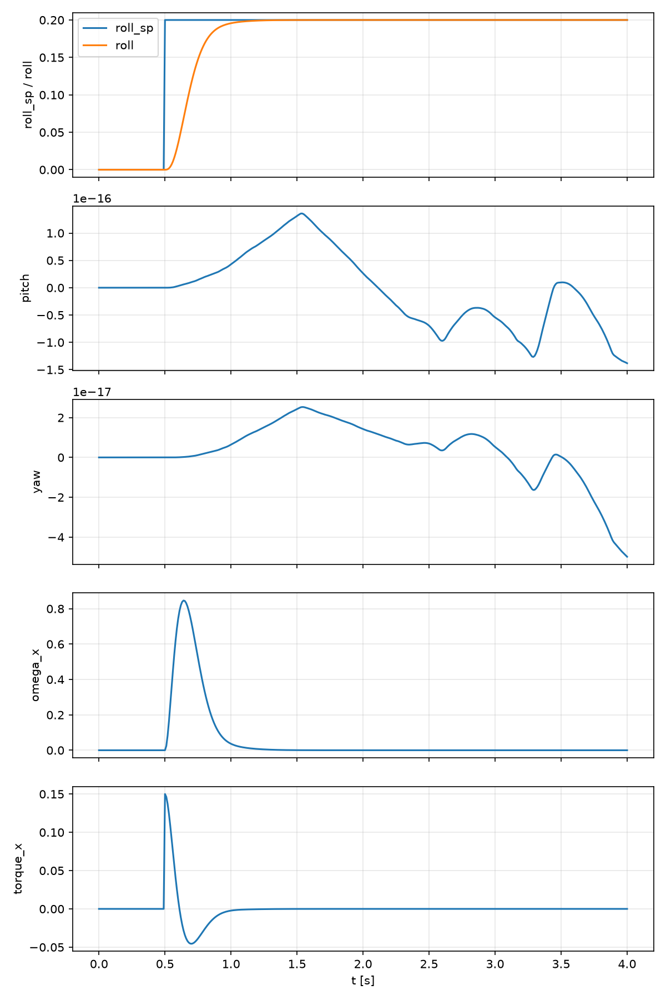
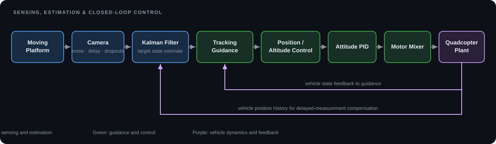

# Landing Simulator

A from-scratch C++17 quadcopter simulator in which a drone locks onto a moving platform with a noisy, delayed camera, estimates its motion with a Kalman filter, matches its velocity and lands on it. It is phase 1 of a two-repo project: the portable core (math, control, estimation, guidance) is written to move unchanged onto a real drone in landing-drone.

## Status

Working and tested:

- Vec3, quaternion and attitude math, with Euler conversion
- Rigid-body dynamics integrated with RK4
- Quadcopter plant: first-order motor model, X-configuration mixer, thrust and torque from motor speed
- PID controller with derivative-on-measurement, derivative filter and anti-windup
- Cascaded attitude, altitude and position controllers
- Moving platform and a seeded camera model (noise that grows with altitude, delay, dropouts)
- Constant-velocity Kalman filter that handles the camera delay using a history of the quad's own position
- Tracking guidance: velocity-matching feedforward, descent funnel, rate-limited descent, lost-target hold
- Landing state machine (search, track, match, descend, landed) with hysteresis and wave-off
- Ground contact and touchdown success criteria
- Seeded batch runner with outcome classification

Planned:

- Camera model in the body frame (it currently ignores the quad's tilt and yaw)
- Non-straight platform motion
- The real drone and firmware (landing-drone)

## Results

Batch results are generated from the simulator, not typed in. See [docs/batch_results.md](docs/batch_results.md).

<p align="center">
  
</p>

A single landing (`--scenario land`):

<p align="center">
  
</p>

Controller step responses:

<p align="center">
  
  
  
</p>

## Build and test

```bash
cmake -S . -B build
cmake --build build
ctest --test-dir build --output-on-failure
```

## Run

```bash
.\build\landing_sim.exe --scenario land
.\build\landing_sim.exe --scenario batch --runs 50 --seed 1
python tools\batch_report.py logs\batch.csv --seed 1
python tools\plot.py logs\land.csv --cols plat_x,x err_h rel_speed alt_sp,alt state contact --out docs\land.png
```

Scenarios: `smoke`, `roll_step`, `altitude_step`, `waypoint`, `platform_track`, `camera_demo`, `filter_demo`, `track_descend`, `land`, `batch`.

Plotting needs `pip install -r tools\requirements.txt`. Every run is deterministic for a given seed.

## What counts as a successful landing

All four must hold at ground contact (contact height 0.05 m):

- The vehicle is inside the platform's square
- Descent speed is at most 0.5 m/s
- Speed relative to the platform is at most 0.3 m/s
- Tilt is at most 15 degrees

A run that never touches down within 40 s counts as a failure. The batch randomises the platform's start position (2 to 5 m away, any direction), its heading (platform speed 0.5 m/s), the starting altitude (0.8 to 1.5 m) and the camera seed.

## Conventions

- Body frame: x forward, y right, z down. Gravity acts along +z, and thrust acts along body -z.
- Motors: 0 front-right, 1 front-left, 2 rear-left, 3 rear-right. Motors 0 and 2 spin counter-clockwise seen from above.
- Euler angles are ZYX (yaw, pitch, roll). Positive roll moves the vehicle right, and positive pitch noses up.
- Altitude is -position.z.

## Simulation Architecture

The simulator operates as a closed-loop system. Camera measurements are filtered, guidance generates reference trajectories, and the controller converts them into motor commands. The resulting vehicle state feeds back into the next iteration.

<p align="center">
  
</p>

## Mathematical Model

The quadcopter is modelled as a six-degree-of-freedom rigid body, with three translational and three rotational degrees of freedom.

**Translational Dynamics**

```text
m v̇ = m g + R Fₜ
```

where `m` is vehicle mass, `R` is the body-to-world rotation matrix, and `Fₜ` is the total thrust force in the body frame.

**Rotational Dynamics**

```text
I ω̇ = τ − ω × (Iω)
```

where `I` is the inertia tensor, `ω` is angular velocity, and `τ` is the applied body torque.

Attitude is represented using quaternions to avoid the singularities associated with Euler-angle integration. The equations of motion are numerically integrated using fourth-order Runge–Kutta (RK4).

Motor dynamics are modelled using a first-order response, with individual motor speeds converted into thrust and torque through the X-configuration mixer.

The controller uses cascaded PID loops, while a constant-velocity Kalman filter estimates the moving platform's position and velocity from delayed, noisy camera measurements.

## Layout

```text
landing-sim/
│
├── core/
│   ├── math/
│   ├── control/
│   ├── estimation/
│   ├── guidance/
│   └── quad/
│
├── sim/
│   ├── plant/
│   ├── sensors/
│   ├── pipeline/
│   ├── logger/
│   └── main.cpp
│
├── tests/
│
├── tools/
│   ├── batch_report.py
│   └── plot.py
│
├── docs/
│   ├── batch_results.md
│   ├── simulation-architecture.svg
│   └── ...
│
├── .gitignore
├── CMakeLists.txt
├── LICENSE
└── README.md
```

## Limitations

- Ground contact is idealised: no bounce, friction or tipping.
- The camera reports the platform in the world frame and ignores the vehicle's tilt and yaw.
- The platform moves in a straight line at constant speed on flat ground.
- The vehicle's own position is assumed to be known exactly.
- Vehicle parameters are placeholders, not measurements of a real drone, and the controller gains were tuned on them.

## Design Notes

- The code in `core/` uses no dynamic allocation and no simulator types, so it can run on a flight controller.
- The camera delay is handled by running the filter on capture times and extrapolating its state to the present, which is exact for a constant-velocity model.
