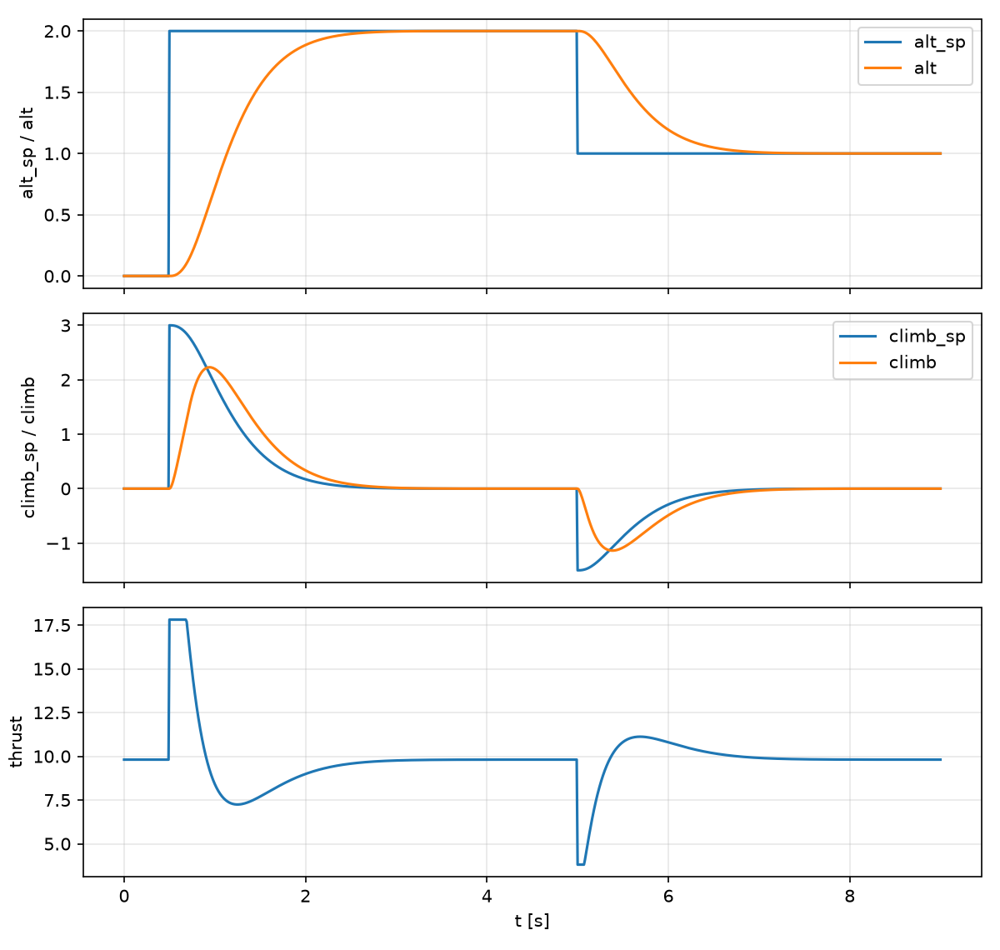
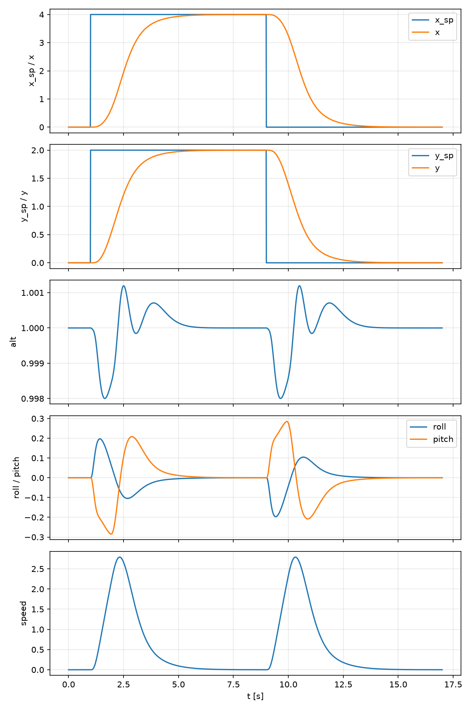

# Landing Simulator

A from-scratch C++17 quadcopter simulator in which a drone will lock onto a moving marker, match its velocity and land on it. It is phase 1 of a two-repo project: the portable control core (math, control) is written to move unchanged onto a real drone in landing-drone.

## Status

Working and tested:

- Vec3, quaternion and attitude math, with Euler conversion
- Rigid-body dynamics integrated with RK4
- Quadcopter plant: first-order motor model, X-configuration mixer, thrust and torque from motor speed
- PID controller with derivative-on-measurement, derivative filter and anti-windup
- Cascaded attitude controller (angle loop into rate loop)
- Altitude controller with gravity feedforward and tilt compensation
- Cascaded position controller (position into velocity into tilt) with velocity feedforward
- CSV logging and plotting

Planned:

- Moving platform, noisy and delayed camera model
- Target state filter (Kalman)
- Landing state machine and touchdown detection
- Seeded batch runs (goal: lands on a 0.5 m/s platform in at least 90% of 50 randomized runs)

## Build and test

```
cmake -S . -B build
cmake --build build
ctest --test-dir build --output-on-failure
```

## Run a scenario

```
.\build\landing_sim.exe --scenario roll_step
python tools\plot.py logs\roll_step.csv --cols roll_sp,roll pitch yaw omega_x torque_x --out docs\roll_step.png
```

Scenarios: `smoke`, `roll_step`, `altitude_step`, `waypoint`. Plotting needs `pip install -r tools\requirements.txt`. Columns joined by a comma are drawn on one axis.

## Results

Roll step (0.2 rad), altitude step and waypoint flight:





## Conventions

- Body frame: x forward, y right, z down. Gravity acts along +z, and thrust acts along body -z.
- Motors: 0 front-right, 1 front-left, 2 rear-left, 3 rear-right. Motors 0 and 2 spin counter-clockwise seen from above.
- Euler angles are ZYX (yaw, pitch, roll). Positive roll moves the vehicle right, and positive pitch noses up.
- Altitude is -position.z.

## Layout

- `core/` portable code with no simulator dependencies: `math/`, `control/`, `quad/`
- `sim/` the simulator: `plant/` (rigid body, integrator, Quad), `logger/`, `main.cpp`
- `tests/` unit and closed-loop tests
- `tools/` plotting
- `docs/` result plots

## Design notes

- The controllers in `core/control` use no dynamic allocation and no simulator types, so they can run on a flight controller.
- The motor model and mixer are in `core/quad` for the same reason.