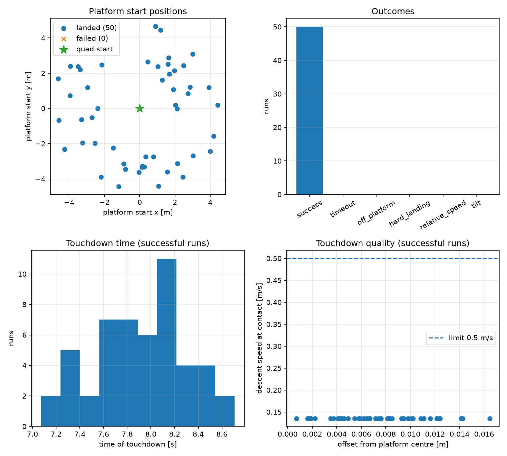

# Batch results

Seed: 1

Landed: 50 of 50 (100.0%)

95% Wilson lower bound: 92.9%

Target of 90% landed: met

| outcome | runs |
| --- | --- |
| success | 50 |
| timeout | 0 |
| off_platform | 0 |
| hard_landing | 0 |
| relative_speed | 0 |
| tilt | 0 |

Successful landings: mean touchdown time 7.9 s, worst offset 0.02 m, worst descent speed 0.14 m/s

Generated by tools/batch_report.py from the output of `landing_sim --scenario batch`.

